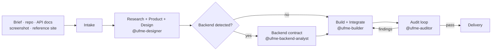

# Universal Frontend Master

An OpenCode skill installed once per **user scope** so `@universal-frontend-master` and the full 6-agent set are available in **every project** on the machine. Cross-project data lives in `~/.config/ufme/`; project-local artifacts live in `.ufme/`.

Turns a brief, existing repo, API docs, screenshot, or reference site into a complete, responsive, accessible, tested frontend — and keeps auditing it until the evidence passes.

[](LICENSE)
[](https://opencode.ai)
[](https://nodejs.org)
[](https://python.org)

```text
@universal-frontend-master Build a complete, professional, responsive website for this project.
```

---

## Why this exists

Most frontend agents write code and stop. This one runs the full engineering loop:

1. **Understand** the brief, existing stack, and backend contract.
2. **Design** the product, design system, and architecture.
3. **Implement** pages, components, state, and API layer.
4. **Test** in a real browser at four viewports.
5. **Audit** visuals, accessibility, performance, and security.
6. **Fix and retest** until each finding is resolved or documented.
7. **Record** every decision in project memory so the next session starts informed.

It never invents endpoints, never forces a framework change without justification, and never installs system packages.

## What you get

- **6 agents** — `universal-frontend-master` (the only primary entry point), `ufme-orchestrator` (delegated orchestration subagent), and 4 specialist subagents, invokable with `@agent-name`.
- **4 execution profiles as sub-commands** — `/profile/lite`, `/profile/standard`, `/profile/advanced`, `/profile/autonomous`, with a conditional agent chain (skip backend when no backend exists, skip designer for single-page edits).
- **Persistent memory** — `.ufme/` artifacts per project; shared cross-project data in `~/.config/ufme/`.
- **Native browser testing** — Selenium WebDriver for Chromium and Firefox, headless by default, screenshots at mobile/tablet/laptop/desktop.
- **Evidence-driven auditors** — axe-core accessibility, Lighthouse performance, pixelmatch visual diffs, and an anti-generic design linter; findings come from script JSON, not eyeballing.
- **Real quality gate** — type check, lint, format, tests, build, browser tests, dependency audit, written to `.ufme/evidence/quality-report.json`.
- **Self-improvement** — the skill audits its own docs, agents, scripts, and install on demand.
- **Library and asset intelligence** — npm research with license checks, plus a shared user-level registry; local asset inventory with duplicate/broken detection.
- **Backend contract parsing** — OpenAPI/Swagger (JSON/YAML), Postman, GraphQL, AsyncAPI, WebSocket/SSE/auth hints.
- **Safety by default** — no sudo, pacman, systemctl, containers, or Playwright; project-local dependencies only; browser sandbox preserved.

## Architecture

### Layers

| Layer | Owner | Responsibility |
|-------|-------|----------------|
| Entry point | `universal-frontend-master` | User-facing primary agent; delegates to orchestrator |
| Orchestration | `ufme-orchestrator` | Plans, delegates, resolves conflicts, enforces acceptance, owns memory |
| Specialists | 4 subagents | Design, backend, build, audit |
| Execution | `scripts/` + `tests/browser/` | Deterministic checks, browser automation, screenshots, quality reports |
| Memory (project) | `.ufme/` | Durable per-project state |
| Memory (cross-project) | `~/.config/ufme/` | Shared library registry and evidence across all projects |

### Pipeline



## Agents

| Agent | Mode | Role | Invoke with |
|-------|------|------|-------------|
| `universal-frontend-master` | primary | Entry point; delegates to orchestrator | `@universal-frontend-master` |
| `ufme-orchestrator` | subagent | Plan, profile enforcement, context packing, delegation, acceptance | N/A (internal) |
| `ufme-designer` | subagent | Research, PRD, sitemap, design system, critique | `@ufme-designer` |
| `ufme-backend-analyst` | subagent | API map, auth map, capabilities, error handling | `@ufme-backend-analyst` |
| `ufme-builder` | subagent | Architecture, pages, components, API client, integration | `@ufme-builder` |
| `ufme-auditor` | subagent | Visual, accessibility, performance, security audits from evidence JSON | `@ufme-auditor` |

## Execution profiles (sub-commands)

Run any time in any project:

- `/profile/lite` — primary + builder (1 concurrent delegate; small edits, quick prototypes)
- `/profile/standard` — balanced for typical frontend projects, including backend integration and audit (default)
- `/profile/advanced` — all six roles for complex projects with full audits
- `/profile/autonomous` — unattended runs with exhaustive verification and every specialist available

Configs live in `universal-frontend-master-source/profiles/`.

## Steer commands

Slash commands to nudge an active session at a specific pass:

| Command | Effect |
|---------|--------|
| `/ufme/audit` | Full audit loop — `browser-test.sh`, `visual-diff.js`, `audit-a11y.js`, `audit-perf.sh`, `detect-slop.py`, `quality-check.py`; `@ufme-auditor` writes `.ufme/AUDIT_REPORT.md` |
| `/ufme/polish` | Fix minor visual/design findings flagged by `detect-slop.py` and `audit-a11y.js` |
| `/ufme/harden` | Security pass — `npm audit` plus a `@ufme-auditor` focused on XSS, CSRF, CSP, secrets, dependency issues |
| `/ufme/critique` | Design critique — `@ufme-designer` reviews the UI against the anti-generic design rules |

## Quick start

### Requirements

- [OpenCode](https://opencode.ai)
- Node.js `^22.23.4`, `^24.22.1`, or `>=26.12.1` (`.nvmrc` pins 24) and npm
- Python 3.9+
- Chromium and/or Firefox (Selenium Manager fetches matching drivers)

Cross-platform by default (Linux, macOS, WSL). Arch Linux is a first-class, tested platform — not a requirement.

### Install once (user scope — all projects)

```bash
curl -fsSL https://raw.githubusercontent.com/Paranthaman-K6/ufms/main/install.sh | bash
```

Install into a specific project directory:

```bash
INSTALL_DIR=/path/to/project \
  curl -fsSL https://raw.githubusercontent.com/Paranthaman-K6/ufms/main/install.sh | bash
```

Reproducible installs are supported: pin a tag with `UFME_TAG` and verify the downloaded tarball with `UFME_TARBALL_SHA256`.

For offline, CI, or local testing, install from a checkout without network access:

```bash
UFME_SOURCE_DIR="$PWD" UFME_SKIP_NPM=1 bash install.sh
```

`UFME_SKIP_NPM=1` leaves the target `package.json` untouched (the tests use it). Repeat installs merge into existing directories instead of nesting them and never overwrite project memory.

The installer:
1. Installs agents, skill, commands, and `opencode.json` **globally** under `~/.config/opencode/` (user scope — available to every project).
2. Stores cross-project shared data in `~/.config/ufme/` (library registry, evidence).
3. Seeds project-local `.ufme/` memory templates into the target project (never overwrites existing).
4. Copies `universal-frontend-master-source/` into the target project.
5. Installs the project-local audit dependency set (`selenium-webdriver`, `@axe-core/webdriverjs`, `lighthouse`, `pngjs`, `pixelmatch`) when the target has a `package.json`.

The installer also copies slash commands globally (`.opencode/commands/ufme/`) and project-locally so `/profile/lite`, `/profile/standard`, `/profile/advanced`, `/profile/autonomous` and `/ufme/*` are available in every project.

### Uninstall

```bash
INSTALL_DIR=/path/to/project bash uninstall.sh            # remove project-local agents/skill/commands/source
bash uninstall.sh --global-only                            # remove global agents/skill/commands
bash uninstall.sh --project-only                            # remove project-local only
```

`uninstall.sh` is idempotent and removes only UFME-managed paths. It preserves project memory (`.ufme/`), `opencode.json`, `package.json`, dependencies and every other user file.


### Run the skill in any project

Open OpenCode in any project directory and start a session with:

```text
@universal-frontend-master Build a complete, professional, responsive website for this project.
```

Or with a specific profile:

```text
/profile/standard Build a product landing page with a contact form.
```

### Run locally from this repo

```bash
git clone https://github.com/Paranthaman-K6/ufms.git
cd ufms
npm install
bash universal-frontend-master-source/scripts/check-native-browser.sh
npm test
```

## How a session runs

1. **Intake** — classify project, detect stack, read environment and memory.
2. **Research + product + design** — references, PRD, sitemap, design system; verify licenses.
3. **Backend contract** (conditional) — parse API docs; only confirmed capabilities become clients.
4. **Build + integrate** — implement, wire API, validate inputs, handle errors.
5. **Browser execution** — real Chromium/Firefox at four viewports, console and network capture.
6. **Audit loop** — visual, accessibility (axe-core), performance (Lighthouse), security; fix and retest against evidence JSON.
7. **Delivery** — quality report, documented limitations, clean handover.

## Repository layout

```text
.
├── .opencode/
│   ├── agents/                     # Installed OpenCode agent definitions (project copy)
│   ├── commands/ufme/              # Steer commands (project copy)
│   └── skills/universal-frontend-master/SKILL.md
├── universal-frontend-master-source/
│   ├── core/                       # MASTER_SKILL.md, architecture, orchestration, rules, safety
│   ├── agents/                     # agent specifications
│   ├── workflows/                  # numbered workflows
│   ├── templates/                  # .ufme/ memory templates
│   ├── scripts/                    # automation scripts (Bash + Python + Node)
│   ├── profiles/                   # 4 execution profiles (lite, standard, advanced, autonomous)
│   ├── integrations/mcp/           # Optional MCP capability discovery
│   ├── docs/                       # Installation, usage, testing, troubleshooting
│   └── examples/
├── tests/
│   ├── browser/                    # Selenium abstraction, engines, security, validation
│   └── regression/                 # Regression suite + fixtures
├── .ufme/                          # Per-project memory and evidence (seeded on install)
├── install.sh                      # User-scope installer (all projects)
├── opencode.json                   # Permission policy
└── README.md
```

## Scripts

| Script | Language | Purpose |
|--------|----------|---------|
| `detect-stack.sh` | Bash | Detect framework, package manager, scripts, entry points |
| `detect-platform.sh` | Bash | Detect OS platform and browser availability |
| `backend-discovery.sh` | Bash | Locate backend contracts and source hints |
| `enhance-backend-discovery.py` | Python | Parse OpenAPI, Postman, GraphQL, AsyncAPI into contracts |
| `search-libraries.py` | Python | Search user + project registry, then npm; select/approve |
| `discover-assets.py` | Python | Inventory images, fonts, icons, video; hashes and duplicates |
| `generate-prototype.py` | Python | Build static prototype from project artifacts |
| `execution-profiles.sh` | Bash | Read and apply execution profile settings |
| `task-checkpoint.py` | Python | Dependency-aware `TASKS.md` state with atomic writes |
| `check-native-browser.sh` | Bash | Verify Selenium WebDriver and browser launch |
| `browser-test.sh` | Bash | Run browser tests and write `browser-results.json` |
| `screenshot.sh` | Bash | Capture browser screenshots (`--budget=viewport\|full`) |
| `page-snapshot.js` | Node | Text-first page outline (structure, headings, landmarks) |
| `visual-diff.js` | Node | Visual regression via pixelmatch; baseline vs compare |
| `audit-a11y.js` | Node | axe-core accessibility audit → evidence JSON |
| `audit-perf.sh` | Bash | Lighthouse performance audit → evidence JSON |
| `detect-slop.py` | Python | Anti-generic design linter (templated look, uniform motion) |
| `design-search.py` | Python | Search design reference CSVs (patterns, palettes, type) |
| `api-query.py` | Python | Slice `BACKEND_CONTRACTS` by endpoint, field, or role |
| `ctx-pack.py` | Python | Compose ≤1500-token per-agent briefs from project context |
| `quality-check.py` | Python | Type check, lint, tests, build, browser, dependency audit |
| `self-improve.py` | Python | Audit skill docs, agents, scripts, install; write JSON evidence |
| `build-agents.py` | Python | Generate agent definition files from source specs |
| `seed-project-memory.py` | Python | Seed missing `.ufme/` project files from templates without overwriting existing data |
| `install.sh` | Bash | User-scope install (all projects), cross-project data in `~/.config/ufme/` |
| `uninstall.sh` | Bash | Idempotent scoped uninstall: removes managed agents, skill, commands and source tree; preserves `.ufme/` memory, `opencode.json`, `package.json` |

Python handles parsing and JSON work without `jq` or extra packages; Bash stays for thin orchestration; Node scripts drive browser-adjacent tooling (snapshot, visual diff, axe-core). Runtime dependencies are `selenium-webdriver`, `@axe-core/webdriverjs`, `lighthouse`, `pngjs` and `pixelmatch` (project-local, installed by `install.sh`).

## Testing and evidence

```bash
npm ci                      # pngjs + pixelmatch power visual diffs
npm test                    # every unit/integration suite below
npm run test:browser -- http://localhost:5173   # real Selenium run
python3 universal-frontend-master-source/scripts/self-improve.py
python3 universal-frontend-master-source/scripts/quality-check.py --target http://localhost:5173
```

- `npm test` — browser abstraction, security flags, regression, visual diff, agent structure, quality gate, profiles, context packs, auditor contract, and clean install.
- `test:*` — run one suite: `test:visual`, `test:visual-cross`, `test:agents`, `test:quality`, `test:profiles`, `test:context`, `test:auditor`, `test:install`, `test:uninstall`, `test:perf`.
- `test:browser` — real browser launch, navigation, console/network capture, screenshots; BLOCKED (not silently skipped) when no browser is installed.
- `self-improve.py` — checks every core doc, agent frontmatter, profile, workflow, script syntax and executable bit, browser abstraction file, and install; writes `.ufme/evidence/self-improve-summary.json`.
- `quality-check.py` — runs type/lint/test/build/browser/axe/Lighthouse/slop/visual/dependency checks and writes `.ufme/evidence/quality-report.json`; thresholds are flags or `UFME_*` env vars; reports PASS, FAIL, SKIPPED, or BLOCKED with reasons. `--only audit` treats a11y, perf, slop and visual as **required**: a skipped required check makes the gate BLOCKED, and a check that exits 0 without fresh, valid evidence is FAIL (never PASS). Use `--require <ids|preset>` to apply the same rule to other checks.
- Visual regression: `visual-diff.js` detects changed, missing-baseline, missing-current and size-mismatched screenshots. Ordinary runs never modify the baseline; a missing baseline yields `BASELINE_MISSING` (exit 4) instead of silently seeding one. `--create-baseline` creates one only when absent; `--update-baseline` explicitly replaces it. The quality gate reports BLOCKED when a required visual check has no baseline.
- `execution-profiles.sh --enforce` — validates the proposed delegation against the profile's `primaryAgent`/`allowedAgents`/`maxConcurrentDelegates`, enforcing sequential role availability and the parallel concurrency cap; records `.ufme/evidence/profile-enforcement.json`.
- `ctx-pack.py --agent <role> --task "..."` — writes a task-aware, token-budgeted brief to `.ufme/evidence/ctx-<role>.md`.

Evidence is written to `.ufme/evidence/` so a reviewer can inspect what actually ran.

## Safety model

| Action | Policy |
|--------|--------|
| `sudo`, `pacman`, `systemctl`, `doas`, `pkexec`, `su` | Denied |
| `rm -rf /`, `rm -rf ~` | Denied |
| `git push` | Ask |
| `npm publish` | Denied |
| Dependencies | Project-local only |
| Containers, Playwright | Not used |
| Browser sandbox | Preserved by default; `UFME_CHROME_FLAGS`/`UFME_FIREFOX_FLAGS` (e.g. CI `--no-sandbox`) are an explicit opt-in |
| Missing system dependency | Reported with exact setup command; work marked BLOCKED |

See `opencode.json` and `universal-frontend-master-source/core/SAFETY.md`.

## Documentation

- [Installation (incl. Arch Linux notes)](universal-frontend-master-source/docs/installation-arch-linux.md)
- [Multi-agent usage](universal-frontend-master-source/docs/multi-agent-usage.md)
- [Testing](universal-frontend-master-source/docs/testing.md)
- [Compatibility](universal-frontend-master-source/docs/compatibility.md)
- [Troubleshooting](universal-frontend-master-source/docs/troubleshooting.md)
- [MCP integration](universal-frontend-master-source/docs/mcp-integration.md)
- [System architecture](universal-frontend-master-source/core/SYSTEM_ARCHITECTURE.md)

## Contributing

Keep changes inside the existing structure: source lives in `universal-frontend-master-source/`, installed copies live in `.opencode/`, runtime state lives in `.ufme/`, cross-project shared data in `~/.config/ufme/`. Before opening a pull request, run `npm test` and `python3 universal-frontend-master-source/scripts/self-improve.py`.

## License

MIT © [Paranthaman-K6](https://github.com/Paranthaman-K6). See [LICENSE](LICENSE).
