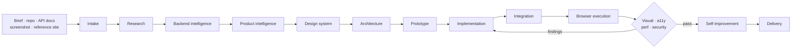

# Universal Frontend Master

An OpenCode skill installed once per **user scope** so `@universal-frontend-master` and all 12 sub-agents are available in **every project** on the machine. Cross-project data lives in `~/.config/ufme/`; project-local artifacts live in `.ufme/`.

Turns a brief, existing repo, API docs, screenshot, or reference site into a complete, responsive, accessible, tested frontend — and keeps auditing it until the evidence passes.

[](LICENSE)
[](https://opencode.ai)
[](https://nodejs.org)
[](https://python.org)

```text
@universal-frontend-master Build a complete, professional, responsive website for this project.
```

---

## Why this exists

Most frontend agents write code and stop. This one runs the full engineering loop:

1. **Understand** the brief, existing stack, and backend contract.
2. **Design** the product, design system, and architecture.
3. **Implement** pages, components, state, and API layer.
4. **Test** in a real browser at four viewports.
5. **Audit** visuals, accessibility, performance, and security.
6. **Fix and retest** until each finding is resolved or documented.
7. **Record** every decision in project memory so the next session starts informed.

It never invents endpoints, never forces a framework change without justification, and never installs system packages.

## What you get

- **13 agents** — `universal-frontend-master` (primary entry point) + `ufme-orchestrator` (primary) + 11 specialist subagents, all invokable with `@agent-name`.
- **4 execution profiles as sub-commands** — `/profile/lite`, `/profile/standard`, `/profile/advanced`, `/profile/autonomous`.
- **14 workflows** — intake, research, backend intelligence, product intelligence, prototype, implementation, integration, browser execution, four audit passes, improvement, delivery.
- **Persistent memory** — `.ufme/` artifacts per project; shared cross-project data in `~/.config/ufme/`.
- **Native browser testing** — Selenium WebDriver for Chromium and Firefox, headless by default, screenshots at mobile/tablet/laptop/desktop.
- **Real quality gate** — type check, lint, format, tests, build, browser tests, dependency audit, written to `.ufme/evidence/quality-report.json`.
- **Self-improvement** — the skill audits its own docs, agents, scripts, and install on demand.
- **Library and asset intelligence** — npm research with license checks, plus a shared user-level registry; local asset inventory with duplicate/broken detection.
- **Backend contract parsing** — OpenAPI/Swagger (JSON/YAML), Postman, GraphQL, AsyncAPI, WebSocket/SSE/auth hints.
- **Safety by default** — no sudo, pacman, systemctl, containers, or Playwright; project-local dependencies only; browser sandbox preserved.

## Architecture

### Layers

| Layer | Owner | Responsibility |
|-------|-------|----------------|
| Entry point | `universal-frontend-master` | User-facing primary agent; delegates to orchestrator |
| Orchestration | `ufme-orchestrator` | Plans, delegates, resolves conflicts, enforces acceptance, owns memory |
| Specialists | 11 subagents | Research, backend, product, design, architecture, build, integrate, audit |
| Execution | `scripts/` + `tests/browser/` | Deterministic checks, browser automation, screenshots, quality reports |
| Memory (project) | `.ufme/` | Durable per-project state |
| Memory (cross-project) | `~/.config/ufme/` | Shared library registry and evidence across all projects |

### Pipeline



## Agents

| Agent | Mode | Role | Invoke with |
|-------|------|------|-------------|
| `universal-frontend-master` | primary | Entry point; delegates to orchestrator | `@universal-frontend-master` |
| `ufme-orchestrator` | primary | Plan, delegation, task state, acceptance, conflict resolution | N/A (internal) |
| `ufme-researcher` | subagent | Requirements, references, library registry, licenses | `@ufme-researcher` |
| `ufme-backend-analyst` | subagent (mandatory) | API map, auth map, capabilities, error handling | `@ufme-backend-analyst` |
| `ufme-product-analyst` | subagent | PRD, sitemap, user flows, feature matrix | `@ufme-product-analyst` |
| `ufme-designer` | subagent | Design system, wireframes, component specs | `@ufme-designer` |
| `ufme-frontend-architect` | subagent | Folder structure, routing, state, data fetching, test strategy | `@ufme-frontend-architect` |
| `ufme-implementer` | subagent | Pages, components, forms, layouts | `@ufme-implementer` |
| `ufme-integrator` | subagent | Typed API client, auth flows, validation, errors | `@ufme-integrator` |
| `ufme-visual-auditor` | subagent (mandatory) | Screenshot review, layout and polish findings | `@ufme-visual-auditor` |
| `ufme-accessibility-auditor` | subagent | WCAG 2.1 AA checks | `@ufme-accessibility-auditor` |
| `ufme-performance-auditor` | subagent | Core Web Vitals, bundle and asset cost | `@ufme-performance-auditor` |
| `ufme-security-auditor` | subagent | XSS, CSRF, CORS, CSP, secrets, dependency audit | `@ufme-security-auditor` |

## Execution profiles (sub-commands)

Run any time in any project:

- `/profile/lite` — minimal agents, shallow research, basic verification (max 2 agents)
- `/profile/standard` — balanced for typical frontend projects (max 4 agents, default)
- `/profile/advanced` — full agents for complex projects with full audits (max 7 agents)
- `/profile/autonomous` — all 12 agents with exhaustive verification (max 12 agents)

Configs live in `universal-frontend-master-source/profiles/`.

## Quick start

### Requirements

- [OpenCode](https://opencode.ai)
- Node.js 18+ and npm
- Python 3.9+
- Chromium and/or Firefox (Selenium Manager fetches matching drivers)

### Install once (user scope — all projects)

```bash
curl -fsSL https://raw.githubusercontent.com/Paranthaman-K6/ufms/main/install.sh | bash
```

Install into a specific project directory:

```bash
INSTALL_DIR=/path/to/project \
  curl -fsSL https://raw.githubusercontent.com/Paranthaman-K6/ufms/main/install.sh | bash
```

The installer:
1. Installs agents, skill, commands, and `opencode.json` **globally** under `~/.config/opencode/` (user scope — available to every project).
2. Stores cross-project shared data in `~/.config/ufme/` (library registry, evidence).
3. Seeds project-local `.ufme/` memory templates into the target project (never overwrites existing).
4. Copies `universal-frontend-master-source/` into the target project.

### Run the skill in any project

Open OpenCode in any project directory and start a session with:

```text
@universal-frontend-master Build a complete, professional, responsive website for this project.
```

Or with a specific profile:

```text
/profile/standard Build a product landing page with a contact form.
```

### Run locally from this repo

```bash
git clone https://github.com/Paranthaman-K6/ufms.git
cd ufms
npm install
bash universal-frontend-master-source/scripts/check-native-browser.sh
npm test
```

## How a session runs

1. **Intake** — classify project, detect stack, read environment and memory.
2. **Research** — gather references, components, fonts, icons; verify licenses.
3. **Backend intelligence** — parse contracts; only confirmed capabilities become clients.
4. **Product** — PRD, sitemap, flows, feature matrix.
5. **Design** — tokens, typography, spacing, component states.
6. **Architecture** — preserve existing stack unless justified in `DECISIONS.md`.
7. **Build and integrate** — implement, wire API, validate inputs, handle errors.
8. **Browser execution** — real Chromium/Firefox at four viewports, console and network capture.
9. **Audits** — visual, WCAG 2.1 AA, Core Web Vitals, security; fix and retest.
10. **Self-improvement** — `scripts/self-improve.py` audits the skill itself.
11. **Delivery** — quality report, documented limitations, clean handover.

## Repository layout

```text
.
├── .opencode/
│   ├── agents/                     # Installed OpenCode agent definitions (project copy)
│   └── skills/universal-frontend-master/SKILL.md
├── universal-frontend-master-source/
│   ├── core/                       # MASTER_SKILL.md, architecture, orchestration, rules, safety
│   ├── agents/                     # 13 agent specifications
│   ├── workflows/                  # 14 numbered workflows
│   ├── templates/                  # .ufme/ memory templates
│   ├── scripts/                    # automation scripts (Bash + Python)
│   ├── profiles/                   # 4 execution profiles (lite, standard, advanced, autonomous)
│   ├── integrations/mcp/           # Optional MCP capability discovery
│   ├── docs/                       # Installation, usage, testing, troubleshooting
│   └── examples/
├── tests/
│   ├── browser/                    # Selenium abstraction, engines, security, validation
│   └── regression/                 # Regression suite + fixtures
├── .ufme/                          # Per-project memory and evidence (seeded on install)
├── install.sh                      # User-scope installer (all projects)
├── opencode.json                   # Permission policy
└── README.md
```

## Scripts

| Script | Language | Purpose |
|--------|----------|---------|
| `detect-stack.sh` | Bash | Detect framework, package manager, scripts, entry points |
| `detect-platform.sh` | Bash | Detect Arch Linux and browser availability |
| `backend-discovery.sh` | Bash | Locate backend contracts and source hints |
| `enhance-backend-discovery.py` | Python | Parse OpenAPI, Postman, GraphQL, AsyncAPI into contracts |
| `search-libraries.py` | Python | Search user + project registry, then npm; select/approve |
| `discover-assets.py` | Python | Inventory images, fonts, icons, video; hashes and duplicates |
| `generate-prototype.py` | Python | Build static prototype from project artifacts |
| `execution-profiles.sh` | Bash | Read and apply execution profile settings |
| `task-checkpoint.py` | Python | Dependency-aware `TASKS.md` state with atomic writes |
| `check-native-browser.sh` | Bash | Verify Selenium WebDriver and browser launch |
| `browser-test.sh` | Bash | Run browser tests and write `browser-results.json` |
| `screenshot.sh` | Bash | Capture viewport screenshots for visual audit |
| `quality-check.py` | Python | Type check, lint, tests, build, browser, dependency audit |
| `self-improve.py` | Python | Audit skill docs, agents, scripts, install; write JSON evidence |
| `install.sh` | Bash | User-scope install (all projects), cross-project data in `~/.config/ufme/` |

Python handles parsing and JSON work without `jq` or extra packages; Bash stays for thin orchestration. Selenium is the only runtime dependency.

## Testing and evidence

```bash
npm test                    # browser validation + security + regression
npm run test:browser        # real Selenium run (Chromium/Firefox)
python3 universal-frontend-master-source/scripts/self-improve.py
python3 universal-frontend-master-source/scripts/quality-check.py
```

- `npm test` — browser abstraction validation, security flags, regression suite.
- `test:browser` — real browser launch, navigation, console/network capture, screenshots; skipped cleanly when no browser is installed.
- `self-improve.py` — checks every core doc, agent frontmatter, workflow, script syntax and executable bit, browser abstraction file, and install; writes `.ufme/evidence/self-improve-summary.json`.
- `quality-check.py` — runs real checks and writes `.ufme/evidence/quality-report.json`; reports PASS, FAIL, SKIPPED, or BLOCKED with reasons.

Evidence is written to `.ufme/evidence/` so a reviewer can inspect what actually ran.

## Safety model

| Action | Policy |
|--------|--------|
| `sudo`, `pacman`, `systemctl`, `doas`, `pkexec`, `su` | Denied |
| `rm -rf /`, `rm -rf ~` | Denied |
| `git push` | Ask |
| `npm publish` | Denied |
| Dependencies | Project-local only |
| Containers, Playwright | Not used |
| Browser sandbox | Preserved; never `--no-sandbox` |
| Missing system dependency | Reported with exact setup command; work marked BLOCKED |

See `opencode.json` and `universal-frontend-master-source/core/SAFETY.md`.

## Documentation

- [Installation on Arch Linux](universal-frontend-master-source/docs/installation-arch-linux.md)
- [Multi-agent usage](universal-frontend-master-source/docs/multi-agent-usage.md)
- [Testing](universal-frontend-master-source/docs/testing.md)
- [Compatibility](universal-frontend-master-source/docs/compatibility.md)
- [Troubleshooting](universal-frontend-master-source/docs/troubleshooting.md)
- [MCP integration](universal-frontend-master-source/docs/mcp-integration.md)
- [System architecture](universal-frontend-master-source/core/SYSTEM_ARCHITECTURE.md)

## Contributing

Keep changes inside the existing structure: source lives in `universal-frontend-master-source/`, installed copies live in `.opencode/`, runtime state lives in `.ufme/`, cross-project shared data in `~/.config/ufme/`. Before opening a pull request, run `npm test` and `python3 universal-frontend-master-source/scripts/self-improve.py`.

## License

MIT © [Paranthaman-K6](https://github.com/Paranthaman-K6). See [LICENSE](LICENSE).
