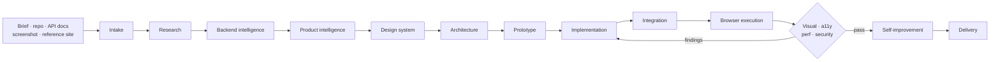

# Universal Frontend Master

An OpenCode skill that turns a brief, an existing repo, API docs, a screenshot, or a reference
site into a complete, responsive, accessible, tested frontend — and keeps auditing it until the
evidence passes.

Built as a multi-agent system with persistent project memory, native Selenium WebDriver testing,
and a hard safety boundary around your machine.

[](LICENSE)
[](https://opencode.ai)
[](https://nodejs.org)
[](https://python.org)

```text
@universal-frontend-master Build a complete, professional, responsive website for this project.
```

---

## Why this exists

Most frontend agents write code and stop. This one runs the full engineering loop:

1. **Understand** the brief, the existing stack, and the backend contract.
2. **Design** the product, the design system, and the architecture.
3. **Implement** pages, components, state, and the API layer.
4. **Test** in a real browser at four viewports.
5. **Audit** visuals, accessibility, performance, and security.
6. **Fix and retest** until each finding is resolved or documented.
7. **Record** every decision in project memory so the next session starts informed.

It never invents endpoints, never forces a framework change without justification, and never
installs system packages.

## What you get

- **12 agents** — one primary orchestrator plus 11 specialists with explicit inputs, outputs,
  permissions, and escalation rules.
- **14 workflows** — intake, research, backend intelligence, product intelligence, prototype,
  implementation, integration, browser execution, four audit passes, improvement, delivery.
- **Persistent memory** — `.ufme/` artifacts for tasks, decisions, environment, architecture,
  API maps, assets, and audit evidence.
- **Native browser testing** — Selenium WebDriver for Chromium and Firefox, drivers resolved by
  Selenium Manager, headless by default, screenshots at mobile/tablet/laptop/desktop.
- **Real quality gate** — type check, lint, format, tests, build, browser tests, dependency audit,
  written to `.ufme/evidence/quality-report.json`.
- **Self-improvement** — the skill audits its own docs, agents, scripts, and install on demand.
- **Library and asset intelligence** — npm research with license checks, plus a shared user-level
  registry; local image/font/icon/video inventory with duplicate and broken-file detection.
- **Backend contract parsing** — OpenAPI/Swagger (JSON or YAML), Postman, GraphQL, AsyncAPI, and
  source hints for WebSocket, SSE, and auth. Capabilities are CONFIRMED, INFERRED, or NOT_FOUND.
- **Safety by default** — no sudo, pacman, systemctl, containers, or Playwright; project-local
  dependencies only; browser sandbox preserved.

## Architecture

### Layers

| Layer | Owner | Responsibility |
|-------|-------|----------------|
| Orchestration | `ufme-orchestrator` | Plans, delegates, resolves conflicts, enforces acceptance criteria, owns memory |
| Specialists | 11 subagents | Research, backend, product, design, architecture, build, integrate, audit |
| Execution | `scripts/` + `tests/browser/` | Deterministic checks, browser automation, screenshots, quality reports |
| Memory | `.ufme/` | Durable state shared across agents and sessions |

### Pipeline



A specialist returns a structured result — status, files, decisions, open questions, blockers,
and the next agent — so the orchestrator can continue without guessing.

### Agents

| Agent | Mode | Owns |
|-------|------|------|
| `ufme-orchestrator` | primary | Plan, delegation, task state, acceptance, conflict resolution |
| `ufme-researcher` | subagent | Requirements, references, library registry, licenses |
| `ufme-backend-analyst` | subagent (mandatory) | API map, auth map, capabilities, error handling |
| `ufme-product-analyst` | subagent | PRD, sitemap, user flows, feature matrix |
| `ufme-designer` | subagent | Design system, wireframes, component specs |
| `ufme-frontend-architect` | subagent | Folder structure, routing, state, data fetching, test strategy |
| `ufme-implementer` | subagent | Pages, components, forms, layouts |
| `ufme-integrator` | subagent | Typed API client, auth flows, validation, errors |
| `ufme-visual-auditor` | subagent (mandatory) | Screenshot review, layout and polish findings |
| `ufme-accessibility-auditor` | subagent | WCAG 2.1 AA checks |
| `ufme-performance-auditor` | subagent | Core Web Vitals, bundle and asset cost |
| `ufme-security-auditor` | subagent | XSS, CSRF, CORS, CSP, secrets, dependency audit |

### Project memory

| Artifact | Purpose |
|----------|---------|
| `AGENT_STATE.md` | Current phase, owner, next action |
| `TASKS.md` | Dependency-aware task ledger (`task-checkpoint.py`) |
| `DECISIONS.md` | Approved libraries, architecture choices, trade-offs |
| `ARCHITECTURE.md` | Folder structure, routing, state, data access, boundaries |
| `DESIGN_SYSTEM.md` | Tokens, typography, spacing, components |
| `API_MAP.md` | Confirmed endpoints, schemas, auth, errors |
| `ASSET_MANIFEST.md` | Local assets, hashes, duplicates, license hints |
| `LIBRARY_REGISTRY.md` | Candidate libraries and status |
| `evidence/` | Browser results, screenshots, quality reports |

## Quick start

### Requirements

- [OpenCode](https://opencode.ai) with this repo open
- Node.js 18+ and npm
- Python 3.9+
- Chromium and/or Firefox (Selenium Manager fetches matching drivers)

### Run the skill repo locally

```bash
git clone https://github.com/Paranthaman-K6/ufms.git
cd ufms

npm install
bash universal-frontend-master-source/scripts/check-native-browser.sh
npm test
```

Then open the repo in OpenCode and start a session with:

```text
@universal-frontend-master Build a complete, professional, responsive website for this project.
```

### Install into another project

```bash
curl -fsSL https://raw.githubusercontent.com/Paranthaman-K6/ufms/main/install.sh | bash
```

Install somewhere other than the current directory:

```bash
INSTALL_DIR=/path/to/project \
  curl -fsSL https://raw.githubusercontent.com/Paranthaman-K6/ufms/main/install.sh | bash
```

The installer adds the skill, the agent definitions, and the source tree to the target project,
seeds the `.ufme/` memory files without overwriting existing ones, and creates the shared
library registry at `~/.config/ufme/LIBRARY_REGISTRY.md` (honoring `XDG_CONFIG_HOME`). The
registry is one catalog for every project on the machine.

## How a session runs

1. **Intake** — classify the project, detect the stack, read environment and memory.
2. **Research** — gather references, components, fonts, icons; verify licenses.
3. **Backend intelligence** — parse contracts; only confirmed capabilities become clients.
4. **Product** — PRD, sitemap, flows, feature matrix.
5. **Design** — tokens, typography, spacing, component states.
6. **Architecture** — preserve the existing stack unless a change is justified in `DECISIONS.md`.
7. **Build and integrate** — implement, wire the API, validate inputs, handle errors.
8. **Browser execution** — real Chromium/Firefox at four viewports, console and network capture.
9. **Audits** — visual, WCAG 2.1 AA, Core Web Vitals, and security; fix and retest.
10. **Delivery** — quality report, documented limitations, and a clean handover.

### Execution profiles

| Profile | Use when | Behavior |
|---------|----------|----------|
| `lite` | Small change or quick prototype | Fast path, minimal audits |
| `standard` | Normal feature work | Full implementation and audit loop |
| `advanced` | Production-bound delivery | Stricter gates, deeper audits |
| `autonomous` | Unattended run | Plans and proceeds, escalating only on blocks |

Profiles live in `universal-frontend-master-source/profiles/`.

## Repository layout

```text
.
├── .opencode/
│   ├── agents/                     # Installed OpenCode agent definitions
│   └── skills/universal-frontend-master/SKILL.md
├── universal-frontend-master-source/
│   ├── core/                       # Skill, architecture, orchestration, rules, safety
│   ├── agents/                     # 12 agent specifications
│   ├── workflows/                  # 14 numbered workflows
│   ├── templates/                  # 20 .ufme/ memory templates
│   ├── scripts/                    # 14 automation scripts (Bash + Python)
│   ├── profiles/                   # 4 execution profiles
│   ├── integrations/mcp/           # Optional MCP capability discovery
│   ├── docs/                       # Installation, usage, testing, troubleshooting
│   └── examples/
├── tests/
│   ├── browser/                    # Selenium abstraction, engines, security, validation
│   └── regression/                 # Regression suite + fixtures
├── .ufme/                          # Runtime memory and evidence (project-local)
├── install.sh                      # Project installer
└── opencode.json                   # Permission policy
```

## Scripts

| Script | Language | Purpose |
|--------|----------|---------|
| `detect-stack.sh` | Bash | Detect framework, package manager, scripts, entry points |
| `detect-platform.sh` | Bash | Detect Arch Linux and browser availability |
| `backend-discovery.sh` | Bash | Locate backend contracts and source hints |
| `enhance-backend-discovery.py` | Python | Parse OpenAPI, Postman, GraphQL, AsyncAPI into `BACKEND_CONTRACTS.md` |
| `search-libraries.py` | Python | Search user + project registry, then npm; select/approve |
| `discover-assets.py` | Python | Inventory images, fonts, icons, video; hashes and duplicate groups |
| `generate-prototype.py` | Python | Build a static prototype from project artifacts |
| `execution-profiles.sh` | Bash | Read and apply lite/standard/advanced/autonomous settings |
| `task-checkpoint.py` | Python | Dependency-aware `TASKS.md` state with atomic writes |
| `check-native-browser.sh` | Bash | Verify Selenium WebDriver and browser launch |
| `browser-test.sh` | Bash | Run browser tests and write `browser-results.json` |
| `screenshot.sh` | Bash | Capture viewport screenshots for visual audit |
| `quality-check.py` | Python | Type check, lint, tests, build, browser, dependency audit |
| `self-improve.py` | Python | Audit the skill's own docs, agents, scripts, and install |
| `install.sh` (root) | Bash | Install the skill, agents, source, memory, and shared registry |

Python handles parsing and JSON work without `jq` or extra packages; Bash stays for thin command
orchestration. Selenium is the only runtime dependency.

## Testing and evidence

```bash
npm test                    # browser validation + security + regression
npm run test:browser        # real Selenium run (Chromium/Firefox)
python3 universal-frontend-master-source/scripts/self-improve.py
python3 universal-frontend-master-source/scripts/quality-check.py
```

- `npm test` — browser abstraction validation, security flags, and regression suite.
- `test:browser` — real browser launch, navigation, console/network capture, screenshots; skipped
  cleanly when no browser is installed.
- `self-improve.py` — checks every core doc, agent frontmatter, workflow, script syntax and
  executable bit, browser abstraction file, and install; writes `SELF_IMPROVEMENT.md`.
- `quality-check.py` — runs the project's real checks and writes
  `.ufme/evidence/quality-report.json`; reports PASS, FAIL, SKIPPED, or BLOCKED with reasons.

Evidence is written to `.ufme/evidence/` so a reviewer can inspect what actually ran.

## Safety model

| Action | Policy |
|--------|--------|
| `sudo`, `pacman`, `systemctl`, `doas`, `pkexec`, `su` | Denied |
| `rm -rf /`, `rm -rf ~` | Denied |
| `git push` | Ask |
| `npm publish` | Denied |
| Dependencies | Project-local only |
| Containers, Playwright | Not used |
| Browser sandbox | Preserved; never `--no-sandbox` |
| Missing system dependency | Reported with the exact setup command; work is marked BLOCKED |

See `opencode.json` and `universal-frontend-master-source/core/SAFETY.md`.

## Documentation

- [Installation on Arch Linux](universal-frontend-master-source/docs/installation-arch-linux.md)
- [Multi-agent usage](universal-frontend-master-source/docs/multi-agent-usage.md)
- [Testing](universal-frontend-master-source/docs/testing.md)
- [Compatibility](universal-frontend-master-source/docs/compatibility.md)
- [Troubleshooting](universal-frontend-master-source/docs/troubleshooting.md)
- [MCP integration](universal-frontend-master-source/docs/mcp-integration.md)
- [System architecture](universal-frontend-master-source/core/SYSTEM_ARCHITECTURE.md)

## Contributing

Keep changes inside the existing structure: source lives in
`universal-frontend-master-source/`, installed copies live in `.opencode/`, runtime state lives
in `.ufme/`. Before opening a pull request, run `npm test` and
`python3 universal-frontend-master-source/scripts/self-improve.py`. Add a test or an assert-based
self-check for new non-trivial logic.

## License

MIT © [Paranthaman-K6](https://github.com/Paranthaman-K6). See [LICENSE](LICENSE).
