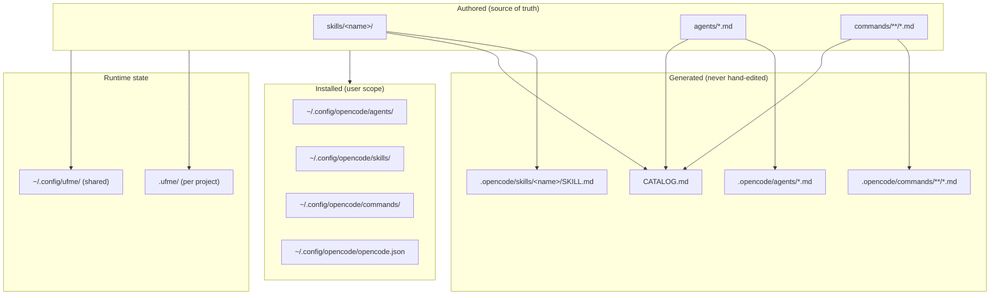
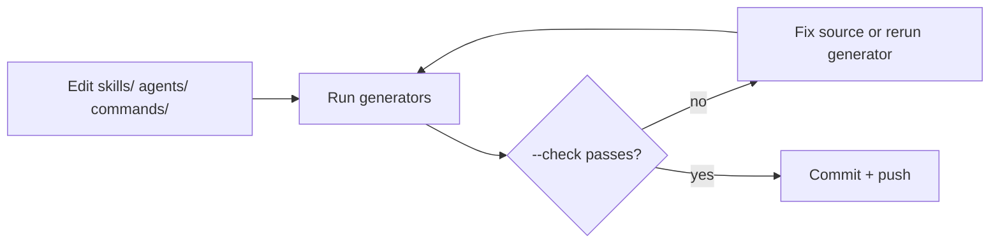
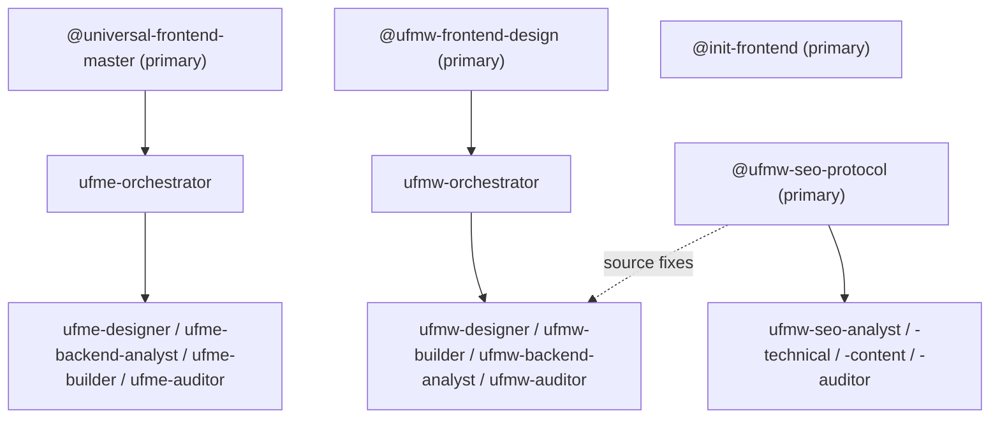
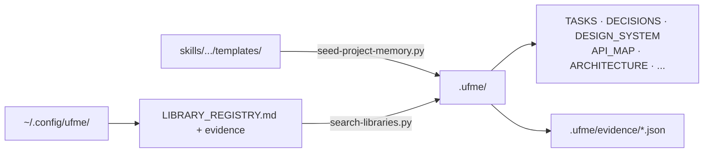
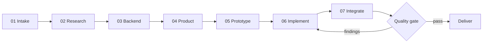
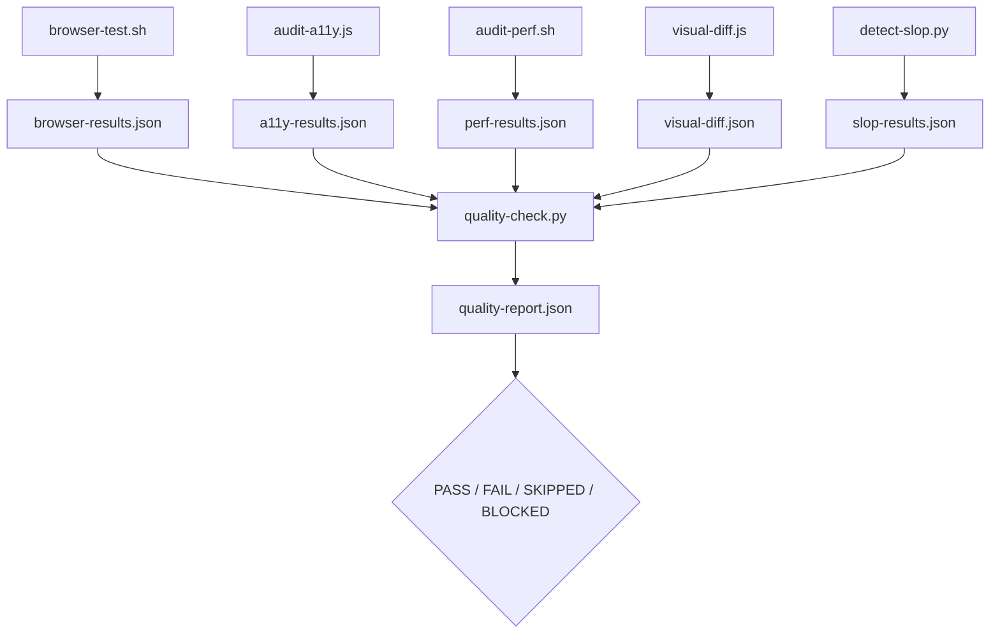

# Architecture

How the repository is put together: what is authored, what is generated, how a
session flows through it, and the invariants that keep the pieces in sync.

- **Audience:** contributors and anyone debugging install or generation drift.
- **Companion docs:** [Development](DEVELOPMENT.md) · [Skills](SKILLS.md) · [Catalog](../CATALOG.md)

---

## 1. System at a glance



Three things are **authored**: skills, agents, and commands. Everything under
`.opencode/` and `CATALOG.md` is **generated**. Anything in `.ufme/` is
**runtime state** produced by a session.

---

## 2. Source of truth and generated mirrors

| Thing | Author here | Generated here | Regenerate with |
|-------|-------------|----------------|-----------------|
| Skills | `skills/<name>/` | `.opencode/skills/<name>/SKILL.md` | `python3 scripts/catalog.py` |
| Agents | `agents/*.md` (flat, final names) | `.opencode/agents/*.md` | `python3 scripts/build-agents.py` |
| Commands | `commands/**/*.md` | `.opencode/commands/**/*.md` | `python3 scripts/catalog.py` |
| Catalog | — | `CATALOG.md` | `python3 scripts/catalog.py` |

Both generators support `--check`, which exits non-zero on drift. CI runs both,
so a hand-edited mirror or a stale catalog fails the build instead of shipping.



---

## 3. Repository map

```text
.
├── skills/                     # four self-contained skills
│   ├── universal-frontend-master/
│   ├── ufmw-frontend-design/
│   ├── ufmw-seo-protocol/
│   └── init-frontend/
├── agents/                     # 17 agent definitions, flat
├── commands/                   # slash commands: ufme/, ufmw/, profile/
├── scripts/                    # repo tooling only (build-agents, catalog)
├── tests/                      # 15 suites, run by npm test
├── registry-server/            # optional Vercel MCP registry
├── docs/                       # this documentation set
├── .opencode/                  # GENERATED mirror
├── .ufme/                      # runtime memory + evidence (gitignored)
├── install.sh / uninstall.sh   # scoped, idempotent
├── opencode.json               # permission policy
└── CATALOG.md                  # GENERATED catalog
```

`scripts/` at the repository root is **repo tooling**. The scripts a skill runs
live inside the skill (`skills/<name>/scripts/`), so an installed skill works
outside a checkout.

---

## 4. Skill anatomy

Every skill is self-contained: installing the folder installs everything it
needs. Optional directories appear only where a skill uses them.

```text
skills/<name>/
├── SKILL.md          # frontmatter + trigger + rules + routing (required)
├── core/             # long-form rules the agent loads on demand
├── workflows/        # numbered passes, e.g. 01-intake → 07-integration
├── scripts/          # deterministic helpers (bash / python / node)
├── templates/        # project-memory and document templates
├── profiles/         # lite / standard / advanced / autonomous JSON
├── browser/          # Selenium abstraction (main skill)
├── data/             # curated CSVs: palettes, fonts, styles, UX rules
├── integrations/     # optional MCP discovery helpers
└── examples/
```

| Directory | Purpose | Loaded when |
|-----------|---------|-------------|
| `SKILL.md` | Entry contract: trigger, hard rules, agent router | Always |
| `core/` | Safety, quality standards, orchestration, memory rules | Referenced by the agent |
| `workflows/` | Ordered passes of the engineering loop | Per session phase |
| `scripts/` | Anything that must be deterministic and repeatable | Invoked by the agent |
| `profiles/` | Delegation limits and allowed agents | Start of a run |
| `templates/` | Seed files for `.ufme/` | Install / first run |

---

## 5. Agents and delegation

All agents are **flat** in `agents/` under their final installed name, so the
file stem is the invocation name.



The **orchestrator is profile-dependent**: `lite` and `standard` delegate
directly to specialists, while `advanced` and `autonomous` route through the
orchestrator. `scripts/execution-profiles.sh --enforce` validates a proposed
delegation against the active profile's allowed agents and concurrency cap.

Frontmatter contract, enforced by `scripts/build-agents.py`:

| Key | Rule |
|-----|------|
| `name` | Must equal the file stem |
| `mode` | `primary` or `subagent` |
| `description` | Non-empty |
| `permission` | Optional; keys limited to `read`, `edit`, `bash`, `task` with `allow` / `deny` / `ask` |

---

## 6. Commands

A command file at `commands/<namespace>/<name>.md` becomes `/<namespace>/<name>`.

| Namespace | Owner skill | Examples |
|-----------|-------------|----------|
| `ufme/` | universal-frontend-master | `/ufme/audit`, `/ufme/polish`, `/ufme/harden`, `/ufme/critique` |
| `ufmw/` | design, SEO, and init-frontend | `/ufmw/build`, `/ufmw/seo-run`, `/ufmw/init-frontend` |
| `profile/` | universal-frontend-master | `/profile/lite` … `/profile/autonomous` |

The full list is generated into [CATALOG.md](../CATALOG.md).

---

## 7. Memory model



| Location | Scope | Lifetime | Contents |
|----------|-------|----------|----------|
| `.ufme/` | One project | Committed by the user | Decisions, task state, design system, evidence JSON |
| `.ufme/evidence/` | One project | Regenerated per run | `a11y-results.json`, `perf-results.json`, `visual-diff.json`, `quality-report.json` |
| `~/.config/ufme/` | Whole machine | Survives reinstalls | Shared library registry, cross-project evidence |

Seeding never overwrites an existing file, so project memory survives reinstall.

---

## 8. Execution pipeline

The main skill runs the same seven phases in every profile; profiles change who
does the work, not the order.



| Profile | Delegation | Use for |
|---------|-----------|---------|
| `lite` | Primary + builder | Small edits, quick prototypes |
| `standard` | Balanced, includes backend + audit | Typical projects |
| `advanced` | All roles, full audits | Complex projects |
| `autonomous` | All roles, exhaustive verification | Unattended runs |

---

## 9. Evidence and the quality gate

Audits do not report from screenshots or intuition; they read script output.



| Status | Meaning |
|--------|---------|
| `PASS` | Check ran, evidence is fresh and within threshold |
| `FAIL` | Check ran and exceeded a threshold, or evidence was missing/stale |
| `SKIPPED` | Preconditions missing (no browser, no URL); never counts as a pass |
| `BLOCKED` | Required check could not run (for example, no visual baseline) |

A required check that is skipped or has stale evidence **blocks** the gate. The
design linter (`detect-slop.py`) is deliberately strict: fix the design, never
the linter.

---

## 10. Registry (optional)

`registry-server/` is a separate deployable: a Vercel function set that speaks
MCP over JSON-RPC and stores one shared library registry. It is optional — the
local Markdown registry is the default — and it fails closed: no configured key
means `503`, a wrong key means `401`.

See [registry-server/README.md](../registry-server/README.md) for endpoints,
storage, and deployment.

---

## 11. Invariants

These are the rules that keep the repository working. A change that breaks one
of them is a bug, not a style choice.

- [ ] `.opencode/` and `CATALOG.md` are never edited by hand.
- [ ] An agent's frontmatter `name` equals its file stem.
- [ ] Skills stay self-contained; an installed skill never reaches back into the repo.
- [ ] Scripts resolve the repo root from their own path, never from `$PWD`.
- [ ] Runtime state goes to `.ufme/`, never into the source tree.
- [ ] The registry fails closed.
- [ ] `detect-slop.py` is not weakened to make a site pass.
