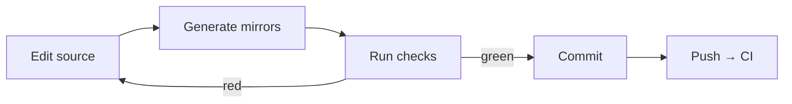
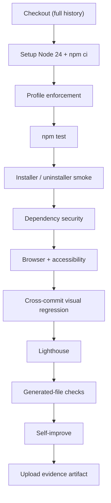

# Development

How to set up the repository, make a change, run the checks CI runs, and ship it.

- **Audience:** contributors and maintainers.
- **Companion docs:** [Architecture](ARCHITECTURE.md) · [Skills](SKILLS.md) · [Testing notes](../skills/universal-frontend-master/docs/testing.md)

---

## 1. Requirements

| Tool | Version | Needed for |
|------|---------|------------|
| Node.js | `^22.23.4`, `^24.22.1`, or `>=26.12.1` (`.nvmrc` pins 24) | Node scripts, browser tooling |
| npm | Bundled with Node | Dependencies, test scripts |
| Python | 3.9+ | Generators, audits, tests |
| Chromium and/or Firefox | Current | Selenium browser runs (Selenium Manager fetches drivers) |

The audit dependencies (`selenium-webdriver`, `@axe-core/webdriverjs`,
`lighthouse`, `pngjs`, `pixelmatch`) are project-local. Nothing requires root.

---

## 2. Setup

```bash
git clone https://github.com/Paranthaman-K6/ufms.git
cd ufms
npm ci
bash skills/universal-frontend-master/scripts/check-native-browser.sh
```

`check-native-browser.sh` confirms the browser binary and Selenium launch before
you spend time on an audit.

---

## 3. The change loop



```bash
python3 scripts/build-agents.py      # validate + mirror agents
python3 scripts/catalog.py           # regenerate CATALOG.md + mirror commands/skills
npm test
```

Never edit `.opencode/` or `CATALOG.md`; regenerate them. `--check` on both
generators is part of `npm test`, so drift fails locally before it fails CI.

---

## 4. Check matrix

| Command | Covers | Typical runtime |
|---------|--------|-----------------|
| `npm test` | Every suite below plus install/uninstall/e2e | Minutes |
| `npm run test:validate` | Browser abstraction contract | Seconds |
| `npm run test:security` | Browser flags, sandbox, blocked binaries | Seconds |
| `npm run test:regression` | Script and doc regressions | Seconds |
| `npm run test:visual` | Visual-diff behaviour and exit codes | Seconds |
| `npm run test:visual-cross` | Base vs HEAD screenshot comparison | Minutes |
| `npm run test:agents` | Agent frontmatter, routing references | Seconds |
| `npm run test:quality` | Quality gate: statuses, stale evidence, slop rules | Seconds |
| `npm run test:theme` | Theme showcase generation | Seconds |
| `npm run test:profiles` | Profile JSON and delegation enforcement | Seconds |
| `npm run test:context` | Context-pack token budgets | Seconds |
| `npm run test:auditor` | Auditor report contract | Seconds |
| `npm run test:perf` | Lighthouse harness | Minutes |
| `npm run test:registry` | Registry auth, MCP tools, seed validity | Seconds |
| `npm run test:install` / `test:uninstall` | Scoped install and idempotent removal | Seconds |
| `npm run test:e2e` | Install → use → uninstall proof | Seconds |
| `npm run test:browser -- http://localhost:5173` | Real Selenium run against a URL | Minutes |
| `python3 skills/universal-frontend-master/scripts/self-improve.py` | Docs, scripts, agents, install self-audit | Seconds |
| `python3 scripts/catalog.py --check` | Catalog + mirror drift | Seconds |
| `python3 scripts/build-agents.py --check` | Agent mirror drift | Seconds |

### Quality gate

```bash
python3 skills/universal-frontend-master/scripts/quality-check.py \
  --only a11y,perf --require a11y,perf \
  --target http://localhost:5173 \
  --report .ufme/evidence/quality-report.json
```

- `--only` selects checks; `--require` makes skipped or stale checks **block**.
- `--only audit` is the strict preset: a11y, perf, slop, and visual.
- Thresholds come from flags or `UFME_*` environment variables.
- A check that exits `0` without fresh evidence is `FAIL`, never `PASS`.

---

## 5. CI pipeline



| Detail | Value |
|--------|-------|
| Workflow | `.github/workflows/ufme-ci.yml` |
| Triggers | Push and pull request to `main` |
| Node | 24 |
| Timeout | 45 minutes |
| Evidence | Uploaded as `ufme-evidence-<sha>` |

The workflow sets `UFME_EVIDENCE_DIR`, `UFME_CHROME_FLAGS` (headless, no sandbox
in CI), and `UFME_LH_MIN_SCORE=80`. The cross-commit step checks out the base
commit, seeds memory, captures screenshots there, and compares them with HEAD.

---

## 6. Adding a skill

```text
skills/<kebab-name>/
├── SKILL.md        # required
├── scripts/
├── templates/
├── workflows/
└── profiles/
```

1. Create `skills/<kebab-name>/SKILL.md` with `name`, `description`, `license`,
   `compatibility: opencode`, and optional `metadata`.
2. Add its entry agent in `agents/<kebab-name>.md` (primary), plus any subagents.
3. Add commands under `commands/<namespace>/`.
4. Regenerate and test:

```bash
python3 scripts/build-agents.py
python3 scripts/catalog.py
npm test
```

Installed skills must stay self-contained: no imports from outside the skill
folder, and no reliance on the repository layout.

## 7. Adding an agent

```markdown
---
name: ufmw-example
mode: subagent
description: One sentence that says what it does and when to use it.
---

# ufmw-example
...
```

The `name` **must** equal the file stem. Allowed frontmatter keys are `name`,
`mode`, `description`, and `permission`; permission keys are limited to `read`,
`edit`, `bash`, and `task` with `allow` / `deny` / `ask`. Run
`python3 scripts/build-agents.py` afterwards.

## 8. Adding a command

Create `commands/<namespace>/<name>.md`. The path becomes the invocation:
`commands/ufmw/build.md` → `/ufmw/build`. Run `python3 scripts/catalog.py` so the
catalog and mirror pick it up.

---

## 9. Contracts worth knowing

**Root resolution.** Scripts find the repository root from their own location,
never from `$PWD`, so they work from any working directory:

| Language | Expression |
|----------|------------|
| Python (skill script) | `Path(__file__).resolve().parents[3]` (script → skill → skills → repo) |
| Python (repo script) | `Path(__file__).resolve().parents[1]` |
| Node | `path.resolve(__dirname, '..', '..', '..')` |

**Evidence freshness.** The quality gate compares the evidence file's mtime with
the run start. A gate that reuses yesterday's JSON reports `FAIL` — that is the
intended behaviour.

**Design gate.** `detect-slop.py` flags templated layouts, uniform entrance
motion, generic gradients, and an empty design system. Fix the design; do not
relax the detector.

---

## 10. Release and deployment

There is no npm publish step (it is denied in `opencode.json`). Users install
from `main`, or pin a tag:

```bash
UFME_TAG=v1.2.0 \
UFME_TARBALL_SHA256=<sha256> \
  bash install.sh
```

The optional registry deploys from `registry-server/` as its own Vercel project
(Root Directory `registry-server`). A push builds; promote by hand when the
production alias lags:

```bash
vercel promote <deployment-url>
```

See [registry-server/README.md](../registry-server/README.md).

---

## 11. Troubleshooting

| Symptom | Cause | Fix |
|---------|-------|-----|
| `evidence is stale` | Gate reused an old JSON file | Run the audit in the same invocation as the gate; check `UFME_EVIDENCE_DIR` |
| Prototype returns 404 | Server not pointed at `prototypes/` | `python3 -m http.server --directory prototypes <port>` |
| Browser check `BLOCKED` | No Chromium/Firefox, or launch failed | Run `check-native-browser.sh`; install a browser |
| `catalog.py --check` fails | Files moved without regenerating | `python3 scripts/catalog.py` |
| `build-agents.py --check` fails | Agent mirror drift or bad frontmatter | `python3 scripts/build-agents.py` |
| Registry `/health` returns `503` | No key configured (fail-closed) | Create a key at the dashboard, or set `REGISTRY_API_KEY` |
| Installed skill cannot find `node_modules` | Global-only install | Reinstall with `INSTALL_SCOPE=both` in the project |
