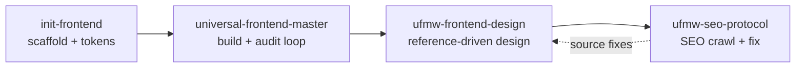

# Skills

The repository ships four skills. Each one is self-contained and installs into
`~/.config/opencode/skills/<name>/`; each has a primary agent you invoke with
`@<agent>`.

| Skill | Entry agent | One line |
|-------|-------------|----------|
| `universal-frontend-master` | `@universal-frontend-master` | Full engineering loop: design, build, test, audit, fix, record |
| `ufmw-frontend-design` | `@ufmw-frontend-design` | Reference-driven design: analyze a site, adapt elements, verify |
| `ufmw-seo-protocol` | `@ufmw-seo-protocol` | Technical and on-page SEO: crawl, plan, fix, verify, monitor |
| `init-frontend` | `@init-frontend` | Scaffold a project with a design system before writing code |

The generated [CATALOG.md](../CATALOG.md) lists every skill, agent, and command
with its exact path. This page explains how the pieces fit together.



---

## universal-frontend-master

The main skill and the default agent. It runs the same seven phases in every
profile and records each decision in project memory.

```text
skills/universal-frontend-master/
├── SKILL.md
├── core/           # 9 rule documents (safety, quality, orchestration, memory)
├── workflows/      # 01-intake → 07-integration
├── scripts/        # 36 deterministic helpers
├── templates/      # 21 project-memory and document templates
├── profiles/       # lite · standard · advanced · autonomous
├── browser/        # Selenium abstraction (run, viewport, screenshot, engines)
├── data/           # palettes · font_pairings · styles · ux_rules (CSV)
├── integrations/   # MCP capability discovery
└── examples/
```

**Workflows**

| # | Pass | Output |
|---|------|--------|
| 01 | Project intake | Stack, constraints, environment |
| 02 | Research | References, libraries, licenses |
| 03 | Backend intelligence | API and auth maps |
| 04 | Product intelligence | PRD, sitemap, user flows |
| 05 | Prototype | Static prototype |
| 06 | Implementation | Pages, components, API client |
| 07 | Integration | Wired, validated, tested |

**Scripts by job**

| Job | Scripts |
|-----|---------|
| Detection | `detect-stack.sh`, `detect-platform.sh`, `backend-discovery.sh`, `enhance-backend-discovery.py` |
| Research and assets | `search-libraries.py`, `registry-remote.py`, `discover-assets.py`, `design-search.py` |
| Reference pipeline | `reference-inspect.js`, `reference-analyze.py`, `reference-match.py`, `reference-adapt.py`, `reference-verify.js`, `element-catalog.py` |
| Scaffold and prototype | `init-project.py`, `scaffold-app.sh`, `generate-prototype.py`, `theme-showcase.py` |
| Context and tasks | `ctx-pack.py`, `task-checkpoint.py`, `api-query.py`, `execution-profiles.sh` |
| Browser | `check-native-browser.sh`, `browser-test.sh`, `screenshot.sh`, `page-snapshot.js` |
| Audit | `audit-a11y.js`, `audit-perf.sh`, `visual-diff.js`, `detect-slop.py`, `quality-check.py` |
| Maintenance | `self-improve.py`, `seed-project-memory.py` |

**Commands:** `/ufme/audit`, `/ufme/polish`, `/ufme/harden`, `/ufme/critique`,
and `/profile/{lite,standard,advanced,autonomous}`.

**Profiles**

| Profile | Delegation | Use for |
|---------|-----------|---------|
| `lite` | Primary + builder | Small edits, quick prototypes |
| `standard` | Balanced, includes backend + audit | Typical projects |
| `advanced` | All roles, full audits | Complex projects |
| `autonomous` | All roles, exhaustive verification | Unattended runs |

---

## ufmw-frontend-design

Reference-driven design. Give it URLs, pick the elements you like, and it
analyzes the DOM and computed styles, adapts them to your design system, and
verifies the result.

```text
skills/ufmw-frontend-design/
├── SKILL.md
├── core/SYSTEM_ARCHITECTURE.md
├── workflows/01-reference-discovery.md
└── profiles/       # lite · standard · advanced · autonomous
```

It reuses the main skill's scripts for detection, browser capture, and audits.
In a checkout those live in `skills/universal-frontend-master/scripts/`; after a
global install they live in
`~/.config/opencode/skills/universal-frontend-master/scripts/`.

| Phase | Command | Script |
|-------|---------|--------|
| Add a reference | `/ufmw/reference-add` | — |
| Inspect one element | `/ufmw/reference-inspect` | `reference-inspect.js` |
| Analyze and match | `/ufmw/reference-analyze` | `reference-analyze.py`, `reference-match.py` |
| Adapt to the design system | `/ufmw/design-plan`, `/ufmw/design-implement` | `reference-adapt.py` |
| Verify intent | `/ufmw/design-verify` | `reference-verify.js` |

Other commands: `/ufmw/build`, `/ufmw/init`, `/ufmw/audit`, `/ufmw/report`,
`/ufmw/theme`.

---

## ufmw-seo-protocol

Autonomous SEO engineering: crawl, analyze, plan, implement, verify, report,
monitor. It delegates to four SEO specialists and uses the design skill's builder
for source-code fixes.

```text
skills/ufmw-seo-protocol/
├── SKILL.md
├── scripts/        # seo-analyze · crawl · fix · gsc · monitor · plan · report · verify
└── profiles/       # lite · standard · advanced · autonomous
```

| Command | Script | Output |
|---------|--------|--------|
| `/ufmw/seo-init` | — | SEO project memory |
| `/ufmw/seo-crawl` | `seo-crawl.py` | `seo-crawl.json` |
| `/ufmw/seo-analyze` | `seo-analyze.py` | `seo-results.json` |
| `/ufmw/seo-plan` | `seo-plan.py` | Prioritized plan |
| `/ufmw/seo-fix` | `seo-fix.py` | Applied fixes |
| `/ufmw/seo-verify` | `seo-verify.py` | Re-crawl comparison |
| `/ufmw/seo-report` | `seo-report.py` | Audit report |
| `/ufmw/seo-gsc` | `seo-gsc.py` | Search Console data |
| `/ufmw/seo-monitor` | `seo-monitor.py` | Metric history |
| `/ufmw/seo-run` | all of the above | Full run |

---

## init-frontend

Scaffold first, code second. It asks every design question before writing a
file, then generates tokens, components, and the audit gate.

```text
skills/init-frontend/
├── SKILL.md
├── DOCS.md
├── scripts/        # a11y.cjs · init-audit · init-component · init-frontend · init-template · init-tokens
├── profiles/       # basic · advanced
└── templates/
```

| Command | Does |
|---------|------|
| `/ufmw/init-frontend` | Scaffold a project with a design system |
| `/ufmw/init-frontend-tokens` | Design-token tier + Style Dictionary build |
| `/ufmw/init-frontend-component` | Add a component with states, stories, a11y test |
| `/ufmw/init-frontend-template` | Download a template and apply the principles |
| `/ufmw/init-frontend-audit` | Token audit, a11y, performance budget, responsive check |

It uses `init-project.py` from the main skill to record the answers in
`.ufme/DESIGN_SYSTEM.md` before scaffolding.

---

## Command index

| Namespace | Count | Owner |
|-----------|-------|-------|
| `/ufme/*` | 4 | universal-frontend-master |
| `/ufmw/*` | 27 | design, SEO, init-frontend |
| `/profile/*` | 4 | universal-frontend-master |

The full table, including the one-line description of every command, is in
[CATALOG.md](../CATALOG.md#commands).
